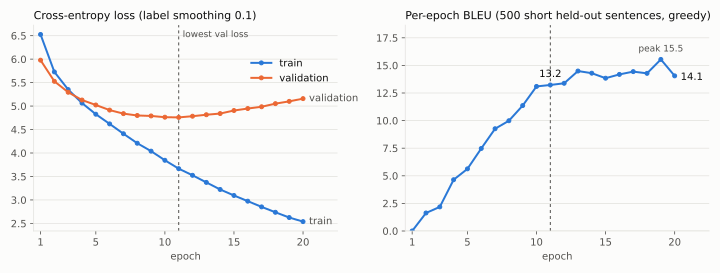

# Attention Is All You Need

PyTorch reproduction of **Attention Is All You Need**  
([Vaswani et al., 2017](https://arxiv.org/abs/1706.03762))

An encoder–decoder Transformer sized like the paper's *base* model (see
[differences from the paper](#differences-from-the-paper)), trained from scratch for
English → Italian translation on the real
[`Helsinki-NLP/opus_books`](https://huggingface.co/datasets/Helsinki-NLP/opus_books) corpus.
The dataset is downloaded automatically from the Hugging Face Hub.

## Results

20 epochs on an Apple M5 (MPS), about 2 hours of training. Both saved checkpoints were
evaluated with greedy decoding on the **full held-out split (3,233 sentences never seen in
training)** and on an equal-sized slice of the training set:

| Checkpoint | Epoch | Val loss | Held-out BLEU | Held-out CER | Held-out WER | Train-slice BLEU |
|---|---|---|---|---|---|---|
| `best.pt` (lowest validation loss) | 11 | **4.759** | 6.14 | **0.679** | 0.897 | 9.71 |
| `tmodel_19.pt` (final epoch) | 20 | 5.159 | **6.96** | 0.682 | **0.885** | 31.12 |



What the numbers show:

- **The model learns to translate, but only roughly.** Short, common sentences come out right
  (*"I love you."* → *"Io ti amo ."*, *"The cat is on the table."* → *"Il gatto è sul tavolo ."*).
  Long literary sentences lose meaning or repeat phrases. A held-out BLEU of ~7 is what a
  75 M-parameter model gets from only 29 k sentence pairs with word-level vocabularies and
  greedy decoding. It is **not** comparable to the paper's 27.3 BLEU (4.5 M pairs, BPE, beam search).
- **Lowest validation loss did not pick the best translator.** Validation loss bottoms out at
  epoch 11 and then rises, yet the final epoch scores +0.8 BLEU and lower WER on the same
  held-out sentences (CER is level). With label smoothing, the loss also penalises the model's
  growing over-confidence on words it gets wrong, while its top-ranked words keep improving.
  This is why both checkpoints are evaluated and the final one is reported as the better model.
- **It overfits heavily.** By epoch 20 the model scores 31.1 BLEU on training sentences against
  7.0 on held-out ones, and training loss (2.54) is far below validation loss (5.16). More data,
  a shared BPE vocabulary or stronger regularisation would be the next steps.
- **The per-epoch BLEU in the training log is optimistic.** It is computed on the first 500
  held-out sentences in length-sorted order, which average 9 tokens (vs. 29 for the full split).
  It is useful for tracking the trend, but the full-split numbers above are the real result.
  Per-epoch validation *loss* uses the whole held-out split.

Translations of new sentences, written for this test and not taken from the dataset:

| English | Epoch 11 (`best.pt`) | Epoch 20 (final) |
|---|---|---|
| The cat is on the table. | Il gatto è sulla tavola . | Il gatto è sul tavolo . |
| I love you. | Io ti amo . | Io ti amo . |
| I don't know what to do. | Non so che cosa fare . | Io non so cosa fare . |
| She opened the window and looked at the garden. | Ella aprì la finestra e guardò il giardino . | Aprì lo sportello e guardò il giardino . |
| He was very tired after the long journey. | Era molto lontano da tempo . | Era già stanco per il viaggio . |
| We will leave tomorrow morning. | Ci di cena . | Andammo da domani a desinare . |

More examples, including 15 random held-out sentences with their reference translations, are in
[`results/translations.md`](results/translations.md); all scores are in
[`results/metrics.json`](results/metrics.json). Outputs show punctuation as separate tokens
(`tavolo .`) because the word-level tokenizer does not re-attach it.

## Dataset

| | |
|---|---|
| Source | `Helsinki-NLP/opus_books`, `en-it` config (sentence-aligned public-domain books) |
| Pairs | 32,332 |
| Split | 90 / 10 train / held-out, seeded (`seed=42`): **29,099 train**, **3,233 held-out** |
| Tokenizer | word-level, trained on the corpus (`min_frequency=2`): 15,698 EN / 22,463 IT tokens |
| Sentence length | median ~22 tokens, max 309 |

`opus_books` only ships a `train` split, so a fixed fraction is held out. Because the split is
seeded, `train.py` and `evaluate.py` always use the same held-out sentences.

## Architecture

| Component | Detail |
|---|---|
| Layers (N) | 6 encoder + 6 decoder |
| d_model | 512 |
| Attention heads (h) | 8 |
| d_ff | 2048 |
| Dropout | 0.1 |
| Positional encoding | Sinusoidal |
| Label smoothing | 0.1 |
| Parameters | 75.2 M |
| Optimizer | Adam (lr=1e-4 constant, ε=1e-9) |
| Batching | ≤ 32 sentences and ≤ 2,048 padded tokens per batch, length-bucketed |
| Decoding | Greedy |

### Differences from the paper

The layer counts, dimensions, heads, attention, positional encoding, dropout and label
smoothing follow the paper's base model, but this is **not** an exact replica: it uses
pre-LN and untied embeddings (hence 75.2 M parameters vs. the paper's ~65 M). The training
setup is also scaled down to one laptop GPU and a small dataset, so absolute scores are
**not** comparable to the paper's 27.3 BLEU (WMT'14 EN→DE).

**Architecture**

| | Paper | This repo |
|---|---|---|
| Layer norm | after each sub-layer: `LayerNorm(x + Sublayer(x))` (post-LN) | before each sub-layer: `x + Sublayer(LayerNorm(x))` (pre-LN), plus a final norm after each stack |
| Weight sharing | one matrix shared by both embeddings and the pre-softmax projection | separate source embedding, target embedding and projection (no sharing) |
| Attention dropout | not described (dropout on sub-layer outputs and embeddings only) | dropout also applied to the attention weights |
| LayerNorm formula | standard, `(x − μ) / √(σ² + ε)` | `(x − μ) / (σ + ε)` with unbiased σ |

**Training**

| | Paper | This repo |
|---|---|---|
| Data | WMT'14, 4.5 M pairs | opus_books EN→IT, 32 k pairs |
| Tokenization | shared BPE, ~37 k | separate word-level vocabularies |
| LR schedule | warmup 4,000 steps, then ∝ step⁻⁰·⁵; Adam β₂=0.98 | constant 1e-4; Adam β₂=0.999 |
| Batch | ~25 k source + 25 k target tokens, 8 GPUs | ≤ 2,048 tokens, 1 Apple-silicon GPU (MPS) |
| Decoding | beam search (size 4), checkpoint averaging | greedy, single best checkpoint |

### Efficient batching

`BilingualDataset` pads every sentence to 350 tokens, but the median sentence is ~22 tokens.
`collate_trim` cuts each batch down to its longest sentence, and `LengthBucketSampler` groups
sentences of similar length and caps each batch at 2,048 tokens (as the paper batched by token
count). This changes nothing numerically: the logits for real tokens are identical to the
fully padded forward pass (max difference 0.0, checked). On an Apple M5 it brings an epoch from
~44 min to ~7 min and keeps memory flat on the rare very long sentences.

## Project Structure

```
Attention Is All You Need/
├── transformer/
│   ├── __init__.py          public API
│   ├── model.py             Transformer architecture
│   ├── dataset.py           BilingualDataset, causal_mask, collate_trim, LengthBucketSampler
│   └── config.py            training config + checkpoint paths
├── train.py                 training entry point (metrics JSON, optional W&B)
├── evaluate.py              held-out BLEU/CER/WER, sample translations, training-curve plot
├── translate.py             inference entry point
├── results/                 committed evaluation outputs (written by evaluate.py)
├── output/                  git-ignored: train.log, metrics.json
├── opus_books_weights/      git-ignored: trained model + tokenizers
└── pyproject.toml
```

## Installation

Requires Python ≥ 3.14 and [uv](https://github.com/astral-sh/uv).

```bash
uv sync
```

## Training

```bash
uv run python train.py                 # 20 epochs, resumes from the last checkpoint if present
uv run python train.py --no-resume     # start from scratch
uv run python train.py --epochs 5      # fewer epochs
```

Each epoch prints the training loss, validation loss, and BLEU/CER/WER on 500 held-out
sentences, with two example translations. Per-epoch metrics are written to
`output/metrics.json`.

To also log to [Weights & Biases](https://wandb.ai), run `wandb login` once, then:

```bash
uv run python train.py --wandb
uv run python train.py --wandb --wandb-project my-project
```

This logs the training loss every step, the validation metrics every epoch, and the config.

## The trained model

Training writes to `opus_books_weights/`:

| File | Size | Purpose |
|---|---|---|
| `best.pt` | ~290 MB | weights from the epoch with the lowest validation loss (epoch 11); the default for `translate.py` |
| `tmodel_NN.pt` | ~860 MB | latest full checkpoint (weights + optimizer state), used to resume; replaced every epoch. After the run above this is `tmodel_19.pt` (epoch 20), the better translator |
| `tokenizer_en.json`, `tokenizer_it.json` | < 1 MB | vocabularies the model was trained with; must stay with the checkpoints |

The folder is git-ignored because of its size. Recreate it with `uv run python train.py`.
Training again in the same folder replaces `tmodel_19.pt`, so copy it elsewhere first if you
want to keep it.

## Evaluation

```bash
uv run python evaluate.py
```

Evaluates two checkpoints: `best.pt` (lowest validation loss) and the final `tmodel_NN.pt`.
Each one greedy-translates the full held-out split (3,233 sentences) and an equal-sized slice of
the training set. The checkpoint with the higher held-out BLEU is reported as the winner. It
writes:

- `results/metrics.json`: per-epoch history and both checkpoints' final scores
- `results/translations.md`: held-out and new-sentence translations from both checkpoints, side by side
- `results/training_curves.svg`: loss and BLEU per epoch

Translating 3,233 sentences four times takes about 15 minutes on an Apple M5.

BLEU is corpus BLEU-4 (`torchmetrics.BLEUScore`, ×100), computed after splitting references and
outputs into words and punctuation the same way the tokenizer does, so `tavolo.` and `tavolo .`
count as the same tokens.

## Inference

```bash
uv run python translate.py "The cat is on the table." "Where is the station?"
```

Pass an integer to translate sentence *N* of opus_books and show its reference translation
(the index refers to the whole dataset, so the sentence may be from the training split):

```bash
uv run python translate.py 42
```

`translate.py` loads `best.pt` by default. To use the final epoch, which scored higher in the
evaluation above:

```bash
uv run python translate.py --checkpoint opus_books_weights/tmodel_19.pt "I love you."
```

From Python:

```python
from translate import translate, translate_batch

translate("I love you.")
translate_batch(["Good morning.", "See you tomorrow."], checkpoint="opus_books_weights/tmodel_19.pt")
```

## Logging

All components use Python's `logging` module scoped to `train`, `evaluate`, `translate`, and
`transformer`, so third-party libraries stay quiet.

## Reference

```bibtex
@article{vaswani2017attention,
  title   = {Attention Is All You Need},
  author  = {Vaswani, Ashish and Shazeer, Noam and Parmar, Niki and Uszkoreit, Jakob and Jones, Llion and Gomez, Aidan N and Kaiser, Lukasz and Polosukhin, Illia},
  journal = {Advances in Neural Information Processing Systems},
  year    = {2017}
}
```
